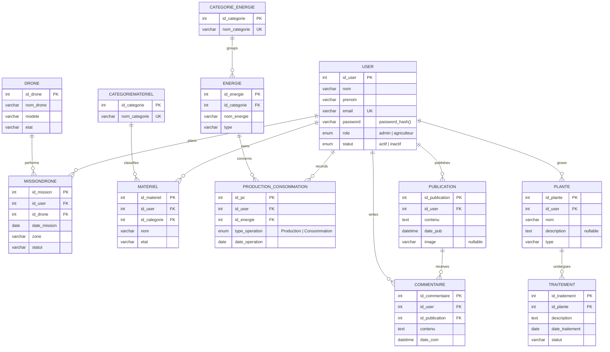

# AgriTech — Database diagram

Source of truth: [`schema.sql`](../schema.sql). 12 tables, InnoDB, `utf8mb4`, all primary keys `INT UNSIGNED AUTO_INCREMENT`.

Image files: [`images/database.png`](images/database.png) (export) · [`images/database.svg`](images/database.svg) (vector).
To regenerate after a schema change: edit `generate-diagram.js`, then run `node docs/generate-diagram.js docs/images/database.svg` and re-export the PNG (open the SVG in a browser and screenshot it, or use headless Edge/Chrome).

## 1. Mermaid diagram (rendered by GitHub)

## 2. Relationships

### 2.1 One-to-many (1-N)

| Parent (1) | Child (0..N) | Foreign key | ON DELETE |
|---|---|---|---|
| USER | MISSIONDRONE | `MissionDrone.id_user` | CASCADE |
| DRONE | MISSIONDRONE | `MissionDrone.id_drone` | RESTRICT |
| USER | MATERIEL | `Materiel.id_user` | CASCADE |
| CATEGORIEMATERIEL | MATERIEL | `Materiel.id_categorie` | RESTRICT |
| USER | PRODUCTION_CONSOMMATION | `Production_Consommation.id_user` | CASCADE |
| ENERGIE | PRODUCTION_CONSOMMATION | `Production_Consommation.id_energie` | RESTRICT |
| CATEGORIE_ENERGIE | ENERGIE | `Energie.id_categorie` | RESTRICT |
| USER | PUBLICATION | `Publication.id_user` | CASCADE |
| PUBLICATION | COMMENTAIRE | `Commentaire.id_publication` | CASCADE |
| USER | COMMENTAIRE | `Commentaire.id_user` | CASCADE |
| USER | PLANTE | `Plante.id_user` | CASCADE |
| PLANTE | TRAITEMENT | `Traitement.id_plante` | CASCADE |

All foreign keys use `ON UPDATE CASCADE`. CASCADE = deleting the parent deletes its rows; RESTRICT = the parent cannot be deleted while rows still use it.

### 2.2 Many-to-many (N-N)

There is no pure join table: each N-N relationship goes through an **association table** that carries its own data (shown in gold on the image).

| Relationship | Association table | Extra data |
|---|---|---|
| USER N ⟷ N DRONE (a user uses several drones, a drone serves several users) | MISSIONDRONE | `date_mission`, `zone`, `statut` |
| USER N ⟷ N ENERGIE (a user produces/consumes several energies) | PRODUCTION_CONSOMMATION | `type_operation`, `date_operation` |
| USER N ⟷ N PUBLICATION (a user comments several publications) | COMMENTAIRE | `contenu`, `date_com` |

### 2.3 One-to-one (1-1)

None.

## 3. Data dictionary

### User
| Column | SQL type | Key | Description |
|---|---|---|---|
| `id_user` | INT UNSIGNED | PK | Identifier |
| `nom` | VARCHAR(100) | | Last name |
| `prenom` | VARCHAR(100) | | First name |
| `email` | VARCHAR(190) | UNIQUE | Login email |
| `password` | VARCHAR(255) | | `password_hash()` output, never plain text |
| `role` | ENUM('admin','agriculteur') | | Default `agriculteur` |
| `statut` | ENUM('actif','inactif') | | Default `actif`; `inactif` = cannot log in |

### Drone
| Column | SQL type | Key | Description |
|---|---|---|---|
| `id_drone` | INT UNSIGNED | PK | Identifier |
| `nom_drone` | VARCHAR(100) | | Drone name |
| `modele` | VARCHAR(100) | | Model |
| `etat` | VARCHAR(50) | | Condition |

### MissionDrone
| Column | SQL type | Key | Description |
|---|---|---|---|
| `id_mission` | INT UNSIGNED | PK | Identifier |
| `id_user` | INT UNSIGNED | FK → User | Farmer who plans the mission |
| `id_drone` | INT UNSIGNED | FK → Drone | Drone used |
| `date_mission` | DATE | | Mission date |
| `zone` | VARCHAR(150) | | Area covered |
| `statut` | VARCHAR(50) | | Mission status |

### CategorieMateriel
| Column | SQL type | Key | Description |
|---|---|---|---|
| `id_categorie` | INT UNSIGNED | PK | Identifier |
| `nom_categorie` | VARCHAR(100) | UNIQUE | Category name |

### Materiel
| Column | SQL type | Key | Description |
|---|---|---|---|
| `id_materiel` | INT UNSIGNED | PK | Identifier |
| `id_user` | INT UNSIGNED | FK → User | Owner |
| `id_categorie` | INT UNSIGNED | FK → CategorieMateriel | Category |
| `nom` | VARCHAR(150) | | Equipment name |
| `etat` | VARCHAR(50) | | Condition |

### Categorie_Energie
| Column | SQL type | Key | Description |
|---|---|---|---|
| `id_categorie` | INT UNSIGNED | PK | Identifier |
| `nom_categorie` | VARCHAR(100) | UNIQUE | Category name (e.g. durable / non durable) |

### Energie
| Column | SQL type | Key | Description |
|---|---|---|---|
| `id_energie` | INT UNSIGNED | PK | Identifier |
| `id_categorie` | INT UNSIGNED | FK → Categorie_Energie | Category |
| `nom_energie` | VARCHAR(100) | | Energy name |
| `type` | VARCHAR(50) | | Energy type |

### Production_Consommation
| Column | SQL type | Key | Description |
|---|---|---|---|
| `id_pc` | INT UNSIGNED | PK | Identifier |
| `id_user` | INT UNSIGNED | FK → User | Farmer |
| `id_energie` | INT UNSIGNED | FK → Energie | Energy concerned |
| `type_operation` | ENUM('Production','Consommation') | | Operation type |
| `date_operation` | DATE | | Operation date |

### Publication
| Column | SQL type | Key | Description |
|---|---|---|---|
| `id_publication` | INT UNSIGNED | PK | Identifier |
| `id_user` | INT UNSIGNED | FK → User | Author |
| `contenu` | TEXT | | Text |
| `date_pub` | DATETIME | | Default `CURRENT_TIMESTAMP` |
| `image` | VARCHAR(255) NULL | | Stored image file name (optional) |

### Commentaire
| Column | SQL type | Key | Description |
|---|---|---|---|
| `id_commentaire` | INT UNSIGNED | PK | Identifier |
| `id_user` | INT UNSIGNED | FK → User | Author |
| `id_publication` | INT UNSIGNED | FK → Publication | Commented publication |
| `contenu` | TEXT | | Text |
| `date_com` | DATETIME | | Default `CURRENT_TIMESTAMP` |

### Plante
| Column | SQL type | Key | Description |
|---|---|---|---|
| `id_plante` | INT UNSIGNED | PK | Identifier |
| `id_user` | INT UNSIGNED | FK → User | Owner |
| `nom` | VARCHAR(150) | | Plant name |
| `description` | TEXT NULL | | Description (optional) |
| `type` | VARCHAR(50) | | Plant type |

### Traitement
| Column | SQL type | Key | Description |
|---|---|---|---|
| `id_traitement` | INT UNSIGNED | PK | Identifier |
| `id_plante` | INT UNSIGNED | FK → Plante | Treated plant |
| `description` | TEXT | | Treatment description |
| `date_traitement` | DATE | | Treatment date |
| `statut` | VARCHAR(50) | | Treatment status |
